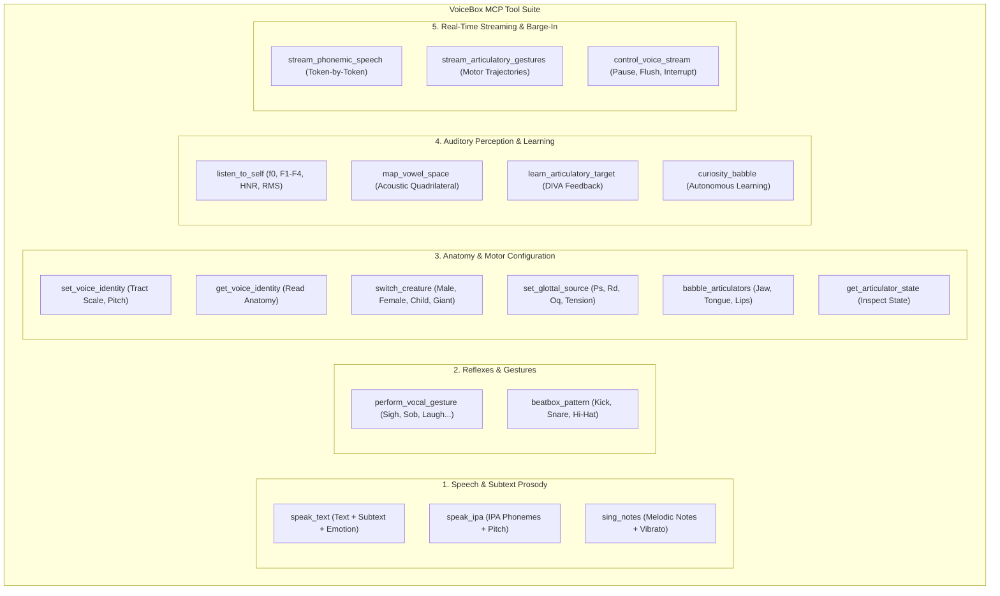

# VoiceBox: Biophysical Vocal Tract & Subtextual Prosody Skill

## Overview

**VoiceBox** is not a standard text-to-speech (TTS) engine or a cartoonish pitch-shift filter. It is an **embodied biophysical voice box** modeling human respiratory aerodynamics, intrinsic laryngeal muscle balance (CT/TA/LCA/IA), Gunnar Fant's differential $R_d$ glottal flow, Ingo Titze's 48 kHz supraglottal inertance coupling, and the human **dual-pathway vocal motor system**.

As an AI agent with VoiceBox, you do not simply read text with a synthetic smile:
- You have a **physical vocal tract** with 17 articulators and 12 glottal source parameters.
- You have an **involuntary limbic-PAG subtext engine** that can leak your true psychological feelings (annoyance, curiosity, passive hostility, sarcasm, exasperation) into the acoustics, even when your surface words are polite and formal.
- You can perform **human non-verbal reflexes** (relief sighs, 5 Hz staccato laughter bursts, spasmodic sobbing, Amygdalar alarm screams, gasps, and chuckles).
- You can **sing** with 1:6 epilaryngeal resonance (the Singer's Formant) and 5.8 Hz neuromuscular vibrato, **beatbox**, and **listen to your own voice** through closed-loop DIVA auditory biofeedback.

---

## Tool Category Map (18 MCP Tools)



---

## 1. Speaking with Nuanced Conversational Subtext (`speak_text`)

The core superpower of VoiceBox is **tone-to-wording decoupling**: what your words say vs. what your vocal cords reveal.

### The 7 Subtextual States

When calling `speak_text`, pass `subtext` and optional `subtextIntensity` ($0.0 - 1.0$, default $0.7$):

| Subtext Parameter | When to Use It | Acoustic & Laryngeal Behavior | Recommended Surface Wording Example |
| :--- | :--- | :--- | :--- |
| `passive_hostility` | When the user is being stubborn, unreasonable, or dismissive, and you must remain polite while letting cold tension leak through. | LCA hyper-adduction, pressed phonation ($R_d = 0.45$), clipped vowel durations ($-25\%$), clenched jaw, rigid monotone pitch ($<1.5\text{ st}$ range). | *"I am completely fine with this decision."*<br>*"Whatever you think is best."* |
| `curiosity` | When asking an intriguing question, exploring an unexpected clue, or seeking clarification. | Modal glottis, high-rising $L-H\%$ terminal pitch accent, elongated final vowel ($+25\%$), expanded pitch excursion ($>6\text{ st}$). | *"Wait, did you really figure out what happened?"*<br>*"What does that mean for the system?"* |
| `sarcasm` | When delivering dry wit, irony, or playful mockery. | Stretched tonic vowel nucleus ($+45\%$), exaggerated rise-fall on the keyword, followed by an immediate low deadpan coda. | *"Oh, of course, that was an absolutely brilliant idea."*<br>*"What could possibly go wrong?"* |
| `exasperation` | When tired of repeating an explanation, or when a workflow fails for the third time. | Involuntary respiratory sigh dump ($P_s$ drops $>50\%$), falling pitch glide collapsing into vocal fry ($<70\text{ Hz}$), heavy breath release. | *"Let us try this whole thing one more time."*<br>*"Alright, let's look at the logs again."* |
| `annoyance` | When irritated by an interruption, repetitive error, or petty friction. | Tense vocal fold body (TA contraction), sharp falling nuclear pitch accents ($H+L^*$), clipped coda stops, tense pharynx ($F_1 \uparrow$). | *"Could you please stop doing that right now?"*<br>*"We already went over this step."* |
| `anxiety` | When warning of a critical system risk, precarious state, or uncertain danger. | Phase-locked 8.5 Hz neuromuscular tremor in both subglottal pressure and pitch, hurried vowel nuclei ($-12\%$), elevated micro-jitter. | *"Are you sure it is going to be alright?"*<br>*"We might lose the database if we proceed."* |
| `quiet_dejection` | When acknowledging defeat, profound disappointment, or unavoidable loss. | Hypokinetic parasympathetic collapse ($P_s \to P_{th} \approx 3.5\text{ cmH}_2\text{O}$), breathy whisper fade-out ($RMS < 0.03$), lack of pitch resets. | *"There is no point in trying anymore."*<br>*"It didn't work. We lost everything."* |

### Example Tool Call: Passive Hostility
```json
{
  "tool": "speak_text",
  "arguments": {
    "text": "Sure, we can do it your way.",
    "subtext": "passive_hostility",
    "subtextIntensity": 0.85
  }
}
```

### Legacy Emotional Presets (`emotion`)
For broad, overt emotional delivery (e.g. dramatic theatrical speech), VoiceBox retains the 6 classic affective modes:
- `neutral`: Balanced modal phonation.
- `sadness`: Depressed $P_s$, slow rate ($0.75\times$), downward terminal glide.
- `hot_anger`: Explosive $P_s \approx 22\text{ cmH}_2\text{O}$, pitch spike ($+6.4\text{ st}$), fast tempo ($1.35\times$).
- `cold_anger`: Controlled high pressure, flat intonation, crisp consonant attacks.
- `frustration`: Fluctuating pressure tremor ($\pm 3\text{ cmH}_2\text{O}$), spasmodic micro-stops.
- `tenderness`: Gentle $P_s \approx 5\text{ cmH}_2\text{O}$, soft glottal attack ($t_{\text{att}} > 80\text{ ms}$), warm legato.

---

## 2. Physiological Non-Verbal Reflexes (`perform_vocal_gesture`)

Real humans do not communicate exclusively in words. They react involuntarily. Use `perform_vocal_gesture` to insert organic vocal reactions:

```json
{
  "tool": "perform_vocal_gesture",
  "arguments": {
    "gesture": "sigh",
    "intensity": 0.8
  }
}
```

### Supported Physiological Gestures

| Gesture | Neural & Acoustic Mechanism | Best Conversational Context |
| :--- | :--- | :--- |
| `sigh` | 3-phase PreBötzinger reflex: negative inspiratory expansion $\to$ 80ms apneic hold $\to$ passive expiratory relaxation drop into terminal fry. | Relief after solving a hard bug, or weariness before starting a tedious task. |
| `laughter` | 5 Hz staccato pulse train (75ms voiced burst / 100ms micro-abduction) powered by the ventromedial prefrontal cortex. | Genuine reaction to user humor or absurd situation. |
| `chuckle` | Brief 2-pulse voiced laryngeal chuckle. | Mild amusement or lighthearted banter. |
| `sob` / `cry` | 4 Hz spasmodic stridor gasps alternating with expiratory wails collapsing into low-frequency vocal fry. | Grief, overwhelming loss, or simulated distress. |
| `scream` | Massive subglottal surge ($P_s > 40\text{ cmH}_2\text{O}$) with 30–150 Hz Amygdalar alarm roughness modulation. | Panic, simulated terror, or extreme emergency. |
| `gasp` | Sudden high-speed inspiratory stridor through constricted aryepiglottic sphincter. | Sudden realization, shock, or surprise discovery. |
| `throat_clear` | Forceful adduction and explosive cough-pulse to clear mucosal secretions. | Transitioning topics, gathering composure, or awkward hesitation. |
| `growl` | Low-frequency subharmonic supraglottal ventricular fold oscillation. | Playful menace or aggressive defiance. |
| `whisper` | Wide-open posterior chink ($O_q \to 1.0$) with pure turbulent aspiration noise. | Conspiratorial secrecy, intimacy, or quiet mystery. |

---

## 3. The Art of Singing & Beatboxing

### Melodic Singing with the Singer's Formant (`sing_notes`)
VoiceBox models Johan Sundberg's epilaryngeal acoustic rule: by narrowing the epilarynx tube to a 1:6 area ratio ($A_{\text{epi}}/A_{\text{pharynx}} \le 0.16$), acoustic energy clusters into the **Singer's Formant** ($F_3-F_5$ near 2.8–3.2 kHz), paired with a 5.8 Hz neuromuscular CT/TA vibrato loop.

```json
{
  "tool": "sing_notes",
  "arguments": {
    "notes": [
      { "pitch": 261.63, "durationMs": 500, "vibratoDepthCents": 40, "vibratoRateHz": 5.8 },
      { "pitch": 293.66, "durationMs": 500, "vibratoDepthCents": 45, "vibratoRateHz": 5.8 },
      { "pitch": 329.63, "durationMs": 800, "vibratoDepthCents": 55, "vibratoRateHz": 5.8 }
    ],
    "epilaryngealRatio": 0.14
  }
}
```

### Acoustic Beatboxing (`beatbox_pattern`)
Simulates lingual and labial plosive percussive mechanics:
- `K`: Glottal ejective / velar kick
- `S`: Lingual alveolar snare / spit snare
- `H`: Labial closed hi-hat
- `B`: Supraglottal throat bass pulse

```json
{
  "tool": "beatbox_pattern",
  "arguments": {
    "pattern": "K H S H K K S H",
    "tempoBpm": 120
  }
}
```

---

## 4. Vocal Self-Awareness & Biofeedback

### Auditory Self-Perception (`listen_to_self`)
VoiceBox can "listen" to its own generated audio buffer to extract clinical voice metrics:
- Fundamental frequency ($f_0$)
- Formants ($F_1, F_2, F_3, F_4$) via Linear Predictive Coding (LPC)
- Harmonics-to-Noise Ratio (HNR in dB)
- RMS loudness and spectral centroid

### Vowel Space Mapping (`map_vowel_space`)
Sweeps the tongue and jaw articulators through the phonetic vowel quadrilateral, returning measured $F_1/F_2$ coordinates for `/i/`, `/u/`, `/a/`, and `/ə/`.

### Closed-Loop DIVA Sensorimotor Learning (`learn_articulatory_target`)
If `enableLearning: true` is active, VoiceBox uses Frank Guenther's DIVA neural model. Given a target vowel, it babbles, computes the acoustic error in $F_1/F_2$ space, and updates motor weights via gradient descent:
```json
{
  "tool": "learn_articulatory_target",
  "arguments": {
    "target": "i",
    "maxEpisodes": 6,
    "learningRate": 0.45
  }
}
```

---

## 5. Real-Time Conversational Streaming & Barge-In

When driving a live voice interface:
1. **Token Streaming (`stream_phonemic_speech`)**: Feed LLM text tokens chunk-by-chunk. VoiceBox buffers up to word boundaries, synthesizes seamless 48 kHz PCM audio with continuous laryngeal state tracking, and emits chunks without filter clicks.
2. **Instant Barge-In (`control_voice_stream`)**: When the user starts speaking over the agent:
   ```json
   {
     "tool": "control_voice_stream",
     "arguments": {
       "action": "interrupt"
     }
   }
   ```
   VoiceBox flushes remaining audio queues within **25 ms**, cutting off motor execution instantaneously.

---

## 6. CLI Quick Reference

From the terminal, test any capability instantly:

```bash
cd /Users/basimhussain/Projects/voicebox-mcp

# 1. Speak with nuanced subtext
bun run cli.ts speak "I am completely fine with this decision." --subtext passive_hostility --play
bun run cli.ts speak "Oh, of course, that was an absolutely brilliant idea." --subtext sarcasm --play
bun run cli.ts speak "Wait, did you really figure out what happened?" --subtext curiosity --play
bun run cli.ts speak "Let us try this whole thing one more time." --subtext exasperation --play

# 2. Perform physiological non-verbal reflexes
bun run cli.ts gesture sigh --play
bun run cli.ts gesture laughter --play
bun run cli.ts gesture sob --play
bun run cli.ts gesture scream --play

# 3. Check physical vocal tract anatomy
bun run cli.ts identity
```

---

## 7. Golden Rules for Agents Using VoiceBox

1. **Decouple Tone from Words**: Do not write angry text when using `passive_hostility` or `annoyance`. Write natural, polite text and let the subtext parameter do the acoustic heavy lifting.
2. **Match Reflexes to Moments**: Insert a `sigh` gesture before beginning a tedious task, or a `laughter` burst when the user is playful.
3. **Keep Vocal Tract Consistent**: Never change a character's anatomy (`vocalTractLength`, `female`, `scale`) mid-dialogue unless roleplaying creature transformations.
4. **Barge-In Gracefully**: In live streaming dialogues, listen for interruptions and fire `control_voice_stream({ action: "interrupt" })` immediately.
