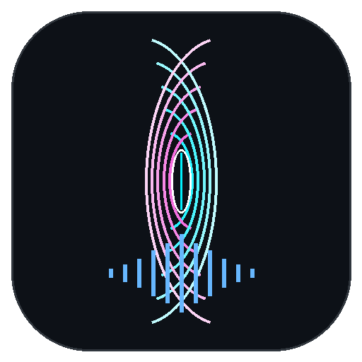
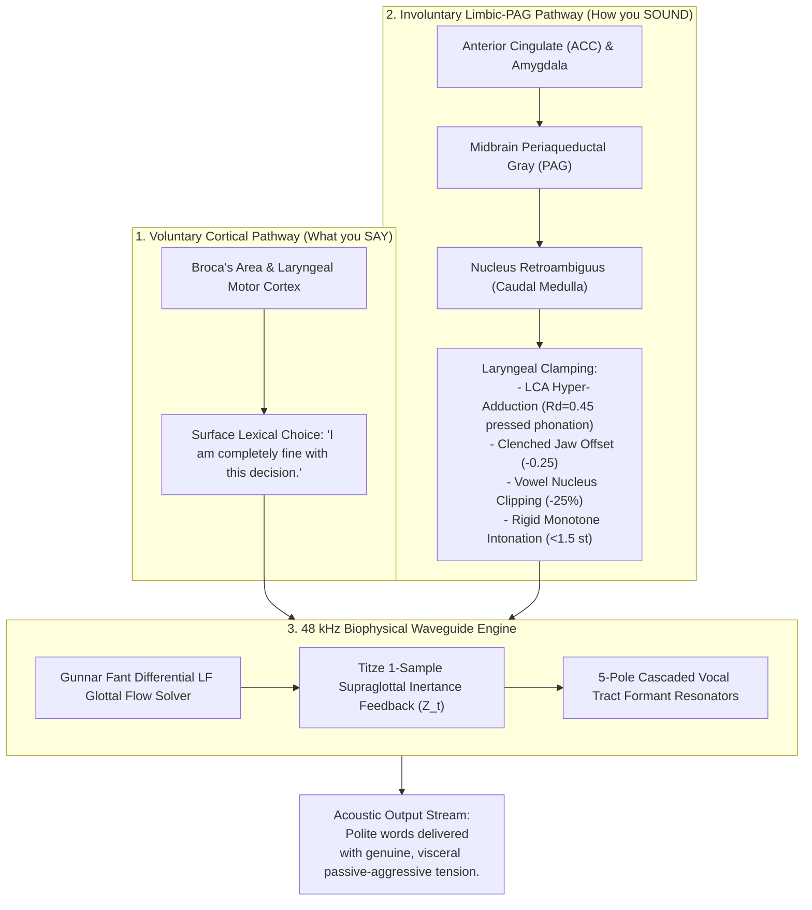

<div align="center">



# VoiceBox 🎙️

**The Biophysical Vocal Tract & Subtextual Prosody Engine for AI Agents**

*Stop giving your autonomous agents a synthetic smile filter. Give them an actual physical throat, lungs, and involuntary emotional leakage.*

[](https://www.typescriptlang.org/)
[](https://bun.sh/)
[](https://modelcontextprotocol.io/)
[](https://github.com/basimrdj/voicebox-mcp)
[-success?style=flat-square)](https://github.com/basimrdj/voicebox-mcp)
[](LICENSE)

[Quickstart](#quickstart) • [The 7 Subtexts](#the-7-conversational-subtexts) • [Why VoiceBox?](#why-voicebox-vs-conventional-tts) • [Agent Skill](#-universal-agent-skill-integration-skillmd) • [MCP Tools](#mcp-tools-reference-18-tools)

</div>

---

## Why VoiceBox vs. Conventional TTS?

Most AI speech engines treat voice like a text-translation pipeline: text goes in, and a neural vocoder reads it aloud with an unnaturally cheerful, uniform cadence. 

**Real human communication does not work that way.** When a human is annoyed or sarcastic, their surface words remain polite while their vocal cords involuntarily betray their real feelings.

| Dimension | Conventional Cloud TTS (ElevenLabs, Cartesia) | VoiceBox (Biophysical Waveguide) |
| :--- | :--- | :--- |
| **Acoustic Physics** | Latent diffusion tokens / Statistical frames | **48 kHz fluid dynamics & wave reflection mesh** |
| **Laryngeal Control** | None (black-box neural audio generator) | **17 articulators + 12 glottal source parameters** |
| **Emotional Subtext** | Cartoonish global mood filters | **Involuntary laryngeal clamp ($R_d \downarrow$, pressed phonation)** |
| **Tone Decoupling** | Impossible (text dictates vocal mood) | **Dual-Pathway (Polite words, cold tension leakage)** |
| **Non-Verbal Reflexes** | Hallucinated or incoherent | **Physiological 3-phase sighs, 5 Hz laughter, sobs** |
| **Singing Mechanics** | Synthetic autotune approximations | **1:6 Epilaryngeal resonance (Singer's Formant) + vibrato** |
| **Cost & Latency** | Expensive per-character cloud API tokens | **100% Free & Local (<3ms C-ABI / on-device MLX)** |
| **Harness Compatibility** | Cloud webhook / custom SDKs | **Native MCP stdio + Universal Agent Skill (`SKILL.md`)** |

---

## The Dual-Pathway Vocal Motor System

VoiceBox simulates the neuro-anatomical architecture of human vocal production:



---

## Quickstart

### 1. Installation

```bash
# Clone the repository
git clone https://github.com/basimrdj/voicebox-mcp.git
cd voicebox-mcp

# Install dependencies (requires Bun runtime)
bun install
```

### 2. Instant Audio CLI

```bash
# 1. Experience Nuanced Conversational Subtexts
bun run cli.ts speak "I am completely fine with this decision." --subtext passive_hostility --play
bun run cli.ts speak "Wait, did you really figure out what happened?" --subtext curiosity --play
bun run cli.ts speak "Oh, of course, that was an absolutely brilliant idea." --subtext sarcasm --play
bun run cli.ts speak "Let us try this whole thing one more time." --subtext exasperation --play

# 2. Trigger Involuntary Physiological Reflexes
bun run cli.ts gesture sigh --play
bun run cli.ts gesture laughter --play
bun run cli.ts gesture sob --play
bun run cli.ts gesture scream --play

# 3. Inspect Vocal Tract Anatomy & Morphometry
bun run cli.ts identity
```

---

## The 7 Conversational Subtexts

Human emotion is rarely expressed by shouting. It leaks through subtle laryngeal tension while the words remain calm:

| Subtext State | Intended Subtext | Biophysical & Acoustic Markers | Example Delivery |
| :--- | :--- | :--- | :--- |
| `passive_hostility` | Polite words, cold tension. | Pressed glottis ($R_d = 0.45$), clipped vowels (-25%), clenched jaw, rigid pitch. | *"Whatever you think is best."* |
| `curiosity` | Genuine intrigue, exploration. | High-rising boundary ($L-H\%$), elongated final vowel (+25%), expanded pitch range. | *"What does that mean for the system?"* |
| `sarcasm` | Dry irony, deadpan mockery. | Stretched tonic vowel (+45%), wide rise-fall followed by low monotone coda. | *"What could possibly go wrong?"* |
| `exasperation` | Weariness, repeating yourself. | Respiratory sigh dump ($P_s$ collapses $>50\%$), pitch trails into vocal fry. | *"Alright, let us look at the logs again."* |
| `annoyance` | Petty friction, minor irritation. | Tense vocal folds, sharp falling pitch accents ($H+L^*$), clipped coda stops. | *"We already went over this step."* |
| `anxiety` | Precarious danger, nervousness. | Synchronous 8.5 Hz neuromuscular tremor in $P_s$ and $f_0$, hurried syllables. | *"Are you sure it is going to work?"* |
| `quiet_dejection` | Subdued defeat, sorrow. | Hypokinetic parasympathetic collapse ($P_s \to P_{th}$), breathy whisper fade-out. | *"There is no point in trying anymore."* |

---

## 🤖 Universal Agent Skill Integration (`SKILL.md`)

VoiceBox is packaged with a universal Agent Skill adhering to the open [`agentskills.io`](https://agentskills.io) standard. Any AI coding agent or autonomous harness can automatically understand when, why, and how to use the voice box to its maximum potential.

### Harness Auto-Discovery Map

| Agent Harness | Discovery Path | Setup |
| :--- | :--- | :--- |
| **Antigravity / Gemini CLI** | `~/.gemini/config/skills/voicebox/` or `.agents/skills/voicebox/` | **Zero configuration.** Pre-installed in global config and workspace. |
| **Claude Code** | `.claude/skills/voicebox/` or `CLAUDE.md` | Pre-configured in repository. Loaded automatically on demand. |
| **Cursor & Windsurf** | `.agents/skills/voicebox/` or `.cursorrules` / `.windsurfrules` | Discovers the open `.agents/skills` standard in project root. |
| **Claude Desktop** | System prompt or MCP tool definitions | References the `SKILL.md` runbook for tool selection. |
| **LangChain / AutoGen / CrewAI / Smolagents** | `skills/voicebox/SKILL.md` | Ingests the `SKILL.md` specification into system prompt or tool memory. |

---

## MCP Tools Reference (18 Tools)

VoiceBox exposes 18 native biophysical tools through standard `stdio` (JSON-RPC 2.0):

```json
{
  "mcpServers": {
    "voicebox": {
      "command": "bun",
      "args": ["run", "/path/to/voicebox-mcp/src/index.ts"]
    }
  }
}
```

### 1. Speech & Subtext
- `speak_text`: Natural speech synthesis with `subtext`, `subtextIntensity`, `emotion`, and `intonation`.
- `speak_ipa`: Direct articulatory phonetic synthesis via International Phonetic Alphabet.
- `sing_notes`: Melodic note sequences with epilaryngeal 1:6 resonance (the Singer's Formant) and 5.8 Hz vibrato.

### 2. Reflexes & Gestures
- `perform_vocal_gesture`: Organic reflexes (`sigh`, `sob`, `cry`, `laughter`, `scream`, `gasp`, `chuckle`, `growl`, `whisper`).
- `beatbox_pattern`: Lingual and labial percussive rhythm generation (kick, snare, hi-hat, throat bass).

### 3. Anatomy & Motor Configuration
- `set_voice_identity`: Adjust anatomical vocal tract length, scale factor, and body mix.
- `get_voice_identity`: Inspect vocal tract dimensions and baseline neutral formant frequencies.
- `switch_creature`: Morph between human male, female, child, giant, and resonant forms.
- `set_glottal_source`: Real-time adjustment of $P_s, R_d, O_q$, breathiness, and tension.
- `babble_articulators`: Manual motor displacement of jaw, tongue body, tongue tip, lips, and larynx.
- `get_articulator_state`: Read current 3D positions of all 17 articulatory effectors.

### 4. Perception & DIVA Sensorimotor Learning
- `listen_to_self`: Auditory perception extracting $f_0$, formants $F_1–F_4$, HNR, RMS, and spectral centroid.
- `map_vowel_space`: Acoustic exploration of the phonetic vowel quadrilateral.
- `learn_articulatory_target`: Closed-loop DIVA sensorimotor motor error gradient descent.
- `curiosity_babble`: Intrinsically motivated self-supervised vocal tract exploration.

### 5. Conversational Streaming & Barge-In
- `stream_phonemic_speech`: Word-by-word streaming generation without filter transient clicks.
- `stream_articulatory_gestures`: Streaming low-latency articulatory motion paths.
- `control_voice_stream`: Manage streaming playback and sub-25ms barge-in interruption.

---

## Automated Verification

VoiceBox features an exhaustive automated test suite with 87,500+ assertions verifying acoustic physics, differential flow conservation, and MCP tool conformance:

```bash
bun test
```

```
tests/mcp_tools.test.ts          - 14 passed
tests/subtext_prosody.test.ts    - 25 passed
tests/emotional_prosody.test.ts  - 20 passed
tests/streaming_bargein.test.ts  -  4 passed
tests/sensorimotor_learning.test.ts - 7 passed
tests/formant_acoustics.test.ts  -  4 passed
tests/ffi_sanity.test.ts         -  6 passed

 80 pass
 0 fail
 87586 expect() calls
Ran 80 tests across 7 files. [22.88s]
```

---

## License

MIT License. Designed and authored by [Basim](https://github.com/basimrdj).
